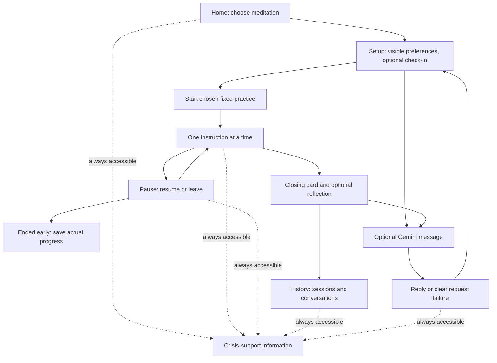

# Still - Assignment 3 Part 1 design plan

Updated October 13, 2026. This is a planning artifact, not a working application or a finished submission. My current scope is Assignment 3.1: research and design for a general meditation experience using the course's paced breathing and sensory grounding skills. It is due October 15, 2026, at 11:59 PM Eastern.

## What I want to make

I want the application to feel like a small meditation space, with general meditation as the framing rather than breathing as the whole product. The first two guided practices will be paced breathing and noticing the surroundings through 5-4-3-2-1 grounding. Both remain the exact course skills. The user gets a small choice between them, then sees one instruction at a time. I am not adding a large library of model-generated meditation or therapeutic exercises.

The working name is **Still**. The application will identify itself as a localhost coursework skills prototype, with fictional scenarios only. It will make no diagnosis, therapy, monitoring, or clinical-effectiveness claim.

The intended first screen asks one simple question, such as "What might feel useful right now?", and offers two short choices: breathing meditation or sensory grounding. This preserves a meaningful choice without turning the home screen into a catalog or dashboard. A previously chosen practice can be gently suggested, with the other choice still visible. History, preferences, and an optional fictional check-in stay easy to reach. Someone can begin without writing a message or waiting for Gemini.

## Two planned practices

| Practice | Fixed course skill | Presentation | Intended exercise time |
| --- | --- | --- | --- |
| Guided breathing meditation | Inhale for four, exhale for six; six cycles | A modest expanding/contracting circle with the phase label and count. A static count view carries the same pace when motion is reduced. | 70 seconds: 5-second opening, 60 seconds of cycles, 5-second closing. |
| Notice your surroundings | Five things seen, four felt, three heard, two smelled, one tasted, in that order | One sensory prompt at a time. The user identifies things privately and presses Next; no typed list is required. | 78-second planning assumption: 4-second opening, 10 seconds reading five prompts, 60 seconds identifying 15 items at four seconds each, 4-second closing. |

These are estimates for design, not measured outcomes. Setup, optional chat, and selecting a practice happen before the first exercise instruction and are reported separately. User-chosen pauses and time accessing crisis information are excluded from active exercise time. The final card stays until the user chooses where to go; a timer never forces the person out.

Grounding's pace is an explicit assumption, not a guarantee that everyone will identify something in four seconds. A user may stay on a prompt, pause, skip an unavailable sense with a recorded skip, or leave. Skipping is not silently labeled completion of the full skill. Both planned sequences leave room below the 90-second assignment limit. Later browser checks will measure from the first instruction through the final planned step, including any application delay.

## Main flow and screen states



The [early screen sketch](early-mockup.svg) shows the two-choice start, breathing exercise, and history. It is a static proposed interface. The app does not exist yet.

- **Home/setup:** short prototype description, one compact choice between the two practices, optional check-in, preferences, History, and Crisis support. The last chosen practice can be suggested, but it does not automatically start. There is no large skill library or mood questionnaire.
- **Exercise:** one large instruction, a phase/count or sensory prompt, progress, Pause, End practice, and Crisis support. Chat is not layered over the exercise. No required text entry.
- **Paused/interrupted:** progress stops; Resume and End practice remain available. Moving the tab into the background will pause rather than catching up and silently completing the exercise. Refresh will show that an unfinished session was interrupted; it will not restart motion without a choice.
- **Closing:** optional one-tap feedback (helpful, neutral, not helpful, or skip). There is no required mood score or claim that the exercise improved someone.
- **History:** date, practice, completed/ended-early/interrupted status, active duration, and any optional reflection. Conversation transcripts are accessible from the same history area. Empty history has a clear first-practice action.
- **Failures:** a model error leaves the fixed practice available; a save error says the record has not been saved and offers retry. There is no invented successful reply or saved record.

## Model role and relevant context

The finished application must demonstrate a conversational model and persisted conversation records, even though chat is optional on the shortest user path. This supports the broader meditation experience without making model use a prerequisite for a basic practice. I plan to reuse our backend Gemini request pattern.

I propose Google Gemini for short fictional check-ins and optional reflections because the backend request pattern was used in the previous course project. The provider and a currently available model ID will be confirmed before implementation; no credential has been copied into this project. Gemini can briefly acknowledge a fictional check-in, explain the two available choices using approved skill descriptions, or summarize an optional reflection. It cannot change the breathing cadence, invent additional therapeutic steps, diagnose, make clinical promises, control navigation, save records directly, or generate database queries.

FastAPI will supply the selected skill's fixed description, explicit display preferences, a bounded recent conversation, and relevant session metadata. It will use parameterized application queries to obtain that context. Suggested limits are 500 characters per user message, the last six messages, the last three session summaries, and a short response of at most three sentences. These are engineering choices to verify later, not observed performance.

Model calls complete outside the exercise sequence. A timeout or provider failure produces a clear message and a fixed application fallback. Credentials stay in a backend-only ignored `.env`. The Gemini model ID will be checked and documented before implementation; no key is copied from the travel project and no new provider account or dependency is assumed at this checkpoint.

## Personalization and user control

To avoid configuration burden, the app can use a prior chosen or positively rated practice as a suggestion, while leaving the alternative visible. It will not require onboarding questions to personalize this suggestion. Explicit accessibility choices, such as text size and motion, remain visible and editable; reduced motion respects the device setting, with a control to reduce motion further. The course breathing rhythm remains four/six even when the display changes. A user can turn off or reset saved preferences.

Remembering those choices reduces repeated setup. The tradeoff is that a previous choice may be wrong for the next session, so preferences remain visible and editable, with Reset. I will not infer distress from typing speed, sentiment, pauses, or a diagnosis. There are no streaks, rewards for continuing, or penalties for leaving.

The user can review and delete saved fictional conversations and sessions. Deleting history will not silently reset explicit display preferences; Reset preferences is a separate control. No account or real personal identity is needed for this local demonstration. Every screen uses low-stimulus, nonjudgmental language; the app does not use clinical phrasing, forced positivity, or language that treats leaving early as failure.

## Crisis-related input and independent access

Every application screen will include a clearly labeled Crisis support control, including while an exercise is active or paused. It opens a locally bundled information panel, without a Gemini call, classifier, or backend request. External support services still require their own connectivity; the basic displayed contact information must remain readable during application/provider failures. This persistent access is part of the interface, not something the user must discover through a sequence of screens.

The proposed U.S. panel links to the official [988 Lifeline](https://988lifeline.org/) call, text, and chat information. Resource wording and any emergency-service wording will be verified against official sources before implementation. The prototype will not initiate a call, contact another person, or imply that someone is watching the conversation.

My proposed response to explicit crisis-related wording is a fixed application message and a prominent copy of that resource panel, instead of relying on a generated exercise recommendation. The first implementation can use a small documented phrase rule for this additional prompt, labeled as limited routing logic rather than a clinical detector. It can miss wording or flag a fictional quotation, so the always-visible support route never depends on it and a failure never removes it. I will keep the triggering message out of saved conversation history when the rule matches; the application can save only that a fixed resource response was shown. The phrase list, user-facing wording, and fictional test cases still need review before implementation.

## Architecture and information saved

| Part | Responsibility |
| --- | --- |
| Vue | Screen state, exercise timing and pacing cues, explicit preferences, pause/exit controls, chat state, history rendering, and locally bundled support panel. |
| FastAPI | Input validation, fixed skill definitions/versioning, bounded Gemini requests, application-owned persistence, history endpoints, and sanitized failures. |
| SQLite | Fictional preferences, conversations, messages, session progress/status, and optional feedback. No hotel records or clinical diagnosis fields. |

### Technology decisions

- **Vue** presents the two practice choices, one-step exercise screens, pause/exit controls, optional check-in, and saved history. The course stack is familiar, and its component state suits a small number of explicit interaction states.
- **FastAPI** validates requests, serves fixed skill steps and support information, supplies bounded context to the model, and performs all persistence. Keeping model calls and credentials on the backend also prevents a model response from taking over exercise timing or navigation.
- **SQLite** provides durable local conversations and exercise history without setting up a remote database. A single fictional local profile is enough for this course prototype; users can inspect and delete their saved records.
- **Gemini through a backend-only request** is the proposed conversational model because the pattern is familiar from the prior assignment. The exact model ID and prompt will be recorded when selected. The core practices and the crisis-support panel work without it.

These are design choices for the required localhost stack. They have not been installed, configured, or tested in the Assignment 3 folder.

Planned storage uses one fictional local demo profile, not authentication:

| Table | Proposed fields and purpose |
| --- | --- |
| preferences | profile ID, last practice, text mode, motion preference, updated timestamp. Explicit choices only. |
| conversations | ID, fictional profile ID, created/updated timestamps. Groups the saved exchange. |
| messages | ID, conversation ID, user/assistant role, text, timestamp, reply status, and live/mock/fixed source. Failed requests remain identifiable. |
| exercise_sessions | ID, practice and script version, start/end, completed/ended-early/interrupted status, last step/cycle, active/paused/wall-clock duration, and optional feedback. |

Saving events uses stable IDs and transactions so a retry does not create duplicate sessions. The interface confirms saved status only after backend acknowledgement. Model context includes only relevant recent records, not the full database. When a limited crisis phrase rule matches, do not save the user's triggering text; the conversation may record only that the fixed resource response was shown.

## Proposed project organization and reuse

I chose a separate project folder: `/Users/treyfoerster/IST 402/Assignment 3`. It has its own documentation and planned frontend/backend areas, with the repository at [Assignment-3 on GitHub](https://github.com/treyfoerster41-creator/Assignment-3). Any future database and `.env` will be local to this project and ignored; no travel data, database, or credential has been copied here.

```text
Assignment 3/
  frontend/              Vue screens and deterministic exercise controls
  backend/
    app/                 FastAPI, fixed skill content, Gemini adapter, persistence
    tests/               Fictional fixtures and mocked behavior checks
    data/                Ignored local skills database
  docs/                  Design, early mockup, research findings and decisions
  evidence/              Dated expected/observed checks and selected failure evidence
  prompts/               Curated instructions and revisions
  handoffs/current.md    Actual state and next implementation task
  README.md              Current milestone, structure, eventual run instructions
  AGENTS.md              Project-specific boundaries and verification rules
  AI-USE.md              Tools, known model identifiers, and roles
  report.md              First-person current milestone submission
  .env.example           Key-free configuration template
  .gitignore             Credentials, local database and generated files
```

I can reuse the course's Vue loading/error-state patterns, FastAPI/HTTPX Gemini transport and safe configuration, SQLite transactions, and mock-provider test patterns. Conversation/session storage, the fixed exercises, and history UI are new. I am not reusing hotel-generated SQL, Geoapify, booking tables, or the existing travel database for this app.

## Research findings and design decisions

The assignment's study table describes coded mentions across 15 participants. I use its counts as evidence of what this class study emphasized, not as proof of clinical benefit or as population-wide statistics. The design decisions below translate each finding into a prototype choice and note where the evidence leaves a question open.

| Code | Finding and reported observation | Design decision for Still |
| --- | --- | --- |
| R1 | Skills longer than 90-100 seconds lose people. Around 60 seconds felt comfortable; after 90-100 seconds attention dropped and participants said they might abandon the exercise. The table reports 38 mentions, concentrated on shorter-is-better and paced breathing. | Keep each complete guided sequence below 90 seconds. The breathing sequence is planned for 70 seconds; grounding is estimated at 78 seconds. Treat these as design targets and measure the actual end-to-end exercise later. |
| R2 | Crisis access must be frictionless. The table reports 30 mentions across all 15 participants; participants wanted safety reachable without navigating through screens. | Keep Crisis support visible in every state and make its information open without model or backend access. |
| R3 | The user must be allowed to stop. The table reports 39 mentions and says all 15 participants raised permission to stop or leave without consequence. | Keep Pause and End practice visible during each exercise. Record early exit neutrally; never block it, scold the user, or mark it as failure. |
| R4 | The user controls their own journey. The table reports 68 mentions, including choosing by emotional state; participants wanted options instead of being routed to one practice. | Offer a small, clear choice between breathing and grounding. A previous choice may be suggested, but never starts automatically or hides the other practice. Avoid asking for a mood disclosure. |
| D1 | Progressive interface contraction. The table reports 54 mentions, especially around crisis access and the overall journey. As distress rises, the interface should contain less; the study does not establish how a system would know distress rose or what should contract. | Keep the exercise screen focused by default. If a simpler view is offered, make it a user-controlled display choice, not an inferred distress response. Keep Crisis support visible in either view. |
| D2 | One atomic skill at a time. The table reports 100 mentions across all 15 participants, centered on STOP, cognitive reframe, and paced breathing; participants responded to one action per screen, not a library, menu, or dashboard. | Once a practice starts, show only its current instruction and essential controls. The initial choice is limited to two short practice options; do not build a catalog or combine skills into a single exercise. |
| D3 | Minimize emotional cost. The table reports 148 mentions across all participants, concentrated on breathing and grounding. It defines cost as what is demanded to feel, disclose, or perform. | No required writing, mood score, or explanation. Sensory identification can stay private; check-in and post-practice feedback are optional and skippable. |
| D4 | Persistently visible safety. The table reports 31 mentions, with participants noticing when safety access disappeared inside an exercise. | Keep the same Crisis support control visible on home, exercise, pause, history, and chat screens. |
| D5 | Personalization without configuration burden. The table reports 49 mentions, especially on lightweight feedback and choosing by emotional state; participants wanted adaptation from prior use without setup. | Use the last chosen practice or optional one-tap feedback as a gentle suggestion, with an immediate alternative and a reset/delete control. Avoid a setup questionnaire. Do not infer emotional state from typing, pauses, or sentiment. |
| D6 | Low-stimulus, nonjudgmental language. The table reports 97 mentions across all 15 participants; participants described clinical phrasing as diagnostic, cheerfulness as condescending, and saturated color or motion as demanding. | Use calm contrast, restrained motion, plain instructions, and neutral completion/exit language. Respect reduced-motion settings and avoid clinical labels or forced cheerfulness. |

The main design tension is between R4's desire for choice and D2's one-skill, one-action screens. I resolve it with two compact practice choices before the exercise, followed by a focused single-skill flow. I do not interpret the study's mention counts as a ranking of therapeutic effectiveness.

Additional interface and accessibility research, reviewed October 13, 2026 with Codex assistance:

- [Calm's breathing-control documentation](https://support.calm.com/hc/en-us/articles/360000069973-Calm-Breathing-Exercises-How-to-Adjust-Speed-Timers-Haptics-Vibrations): describes a visual breathing cue and controls before starting. I adopted the idea of a visible pacing cue. Calm also offers multiple styles and adjustable duration/rate; I am keeping the course's fixed four/six cadence and limiting the first screen to two course skills. I will not repeat the source's health-benefit marketing claims.
- [Headspace's practice catalog](https://www.headspace.com/content/topics/videos-and-more/3): groups short activities under breathing, grounding, and meditation categories and includes one-minute visual activities. This supports presenting breathing and sensory awareness within a broader meditation experience. The page also demonstrates how a catalog can grow large; I am keeping this prototype to two skills and original wording rather than copying content or claims.
- [MDN reduced-motion documentation](https://developer.mozilla.org/en-US/docs/Web/CSS/Reference/At-rules/@media/prefers-reduced-motion): documents the browser/device preference for reducing motion. I plan a static count alternative and a visible control to reduce motion further.
- [Official 988 Lifeline](https://988lifeline.org/): source for U.S. call, text, and chat support information. The app will link to official options and will not initiate contact on the user's behalf.

The instructor supplied the R1-R4/D1-D6 study summary for this assignment. The directions say its mention counts identify where a finding appeared, not clinical effectiveness; no separate research dataset is expected. I did not conduct clinical research or inspect participant-level data.

## Assignment 3 milestones and current scope

| Milestone | Due | Scope in this plan |
| --- | --- | --- |
| 3.1 Research and Design | October 15, 2026, 11:59 PM Eastern | Current work: propose the app and explain the design using the supplied findings. |
| 3.2 Working Application and Safety | October 22, 2026, 11:59 PM Eastern | Later work: demonstrate a coherent working core experience. |
| 3.3 Integration, Evaluation, and Demonstration | October 29, 2026, 11:59 PM Eastern | Later work: refine, evaluate, and explain what was learned. |

I am working on 3.1 only now. The later milestones inform the handoff but are not implementation tasks for this checkpoint.

## Part 1 work and later implementation

Part 1 will contain the finalized design, early mockup, model/context boundaries, data plan, research mapping, reusable project instructions, truthful handoff, and first-person report with accessible repository/design/evidence links and an exact submitted commit. A working application is not expected. The provided Part 1 directions do not explicitly require a demo recording; recordings will be included when relevant to the milestone.

Next work, after the design is accepted:

1. Complete and review the Part 1 documentation and clearly labeled starter structure in the separate Assignment 3 folder.
2. Confirm the repository host/URL, then establish the initial Git checkpoint after the student reviews the files.
3. Add the exact commit and accessible repository link to the report before submission.
4. Stop at the 3.1 checkpoint. The later working-application and integration milestones are future work. The first implementation is expected to prioritize one complete practice; the second practice remains in the design and its implementation scope will be stated honestly.

Later verification will include timer drift/background interruption, pause/end behavior, model/save failures, refreshed/restarted persistence, and crisis access across all states. The final milestone needs at least fifteen fictional scenarios, three explicit behavior checks, a relevant selection of live-model cases, and demonstration/process recordings. Those outcomes have not occurred and will not be claimed in Part 1.

## Decisions still to resolve

- Separate Assignment 3 folder is `/Users/treyfoerster/IST 402/Assignment 3`; GitHub repository: [Assignment-3](https://github.com/treyfoerster41-creator/Assignment-3). The name Still is provisional.
- Final grounding pace and handling of unavailable senses, checked with fictional scenarios.
- Exact crisis-text routing rules and limitations; independent access is already a fixed design requirement.
- Whether Gemini will be the final provider and which available model ID to use. No API key is in this project folder.
- Whether audio is useful enough to include later. The design is text-first, supports reduced motion, and targets Firefox; speech/music is outside the first build.

Current verification: the instructions, screenshots, existing architecture, and cited documentation were reviewed for planning. No application feature, exercise timer, model reply, database schema, or browser behavior was implemented or verified for Assignment 3. No credential, local database, Assignment 2 report, or travel source file was changed.
