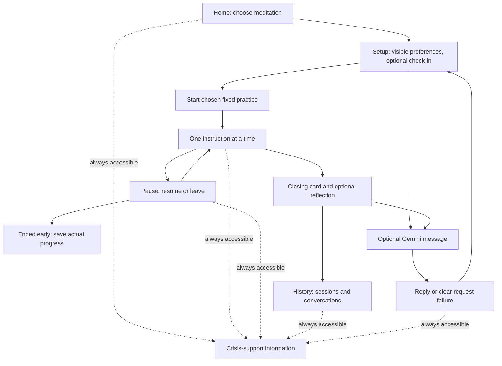

# Still — Assignment 3 design and implementation notes

Updated October 21, 2026. The Assignment 3.1 proposal is retained below. The implementation choices for Assignment 3.2 are recorded first; `report.md` is the current Part 2 submission draft.

## Assignment 3.2 implementation update

The student asked to begin Part 2 and keep the breathing/meditation program as the focus. I narrowed the first working version to one complete course skill: six cycles of a four-second inhale and six-second exhale. The app does not implement the 5-4-3-2-1 practice yet. That is a scope reduction from the Part 1 proposal, not a claim that grounding is complete.

The active exercise is 60 seconds from the first breathing instruction to the sixth exhale. Choosing the practice and waiting for the session-start API response are entry/setup and are reported separately. A user-selected pause stops the active timer; the user can resume or end early. A background tab pauses the practice. Reloading or closing during an unfinished practice records it as interrupted when the app is opened again. No timer forces a choice or navigation.

The exercise advances automatically after one start action. Optional browser speech synthesis can speak the current inhale/exhale cue; it is off by default, does not use a microphone, and leaves the same visible text and shape available. If the browser lacks speech synthesis, the app explains that visual cues remain available. Speech is canceled when the exercise pauses or ends. The control adds no required interaction once practice begins.

The optional check-in remains outside the exercise. FastAPI sends a bounded recent conversation and the current fictional message to Gemini, then persists the user and assistant messages. The system instruction limits the reply to a short, neutral reflection and prohibits diagnosis, therapy claims, advice, or new skill steps. The Vue app owns the exercise script and timer; the model cannot select the page, change breathing counts, write to SQLite, or decide whether Crisis support is visible. With no `GEMINI_API_KEY`, the app shows a fixed response labeled as a mock. A live request failure receives a fixed, sanitized fallback. No Gemini key is present in this project as of this update, so no live model response has been observed.

The model ID is `gemini-3.8-flash`, using Google's documented `generateContent` REST API through backend HTTPX with the API key in the `x-goog-api-key` header. The model and REST pattern were checked against [Google's model list](https://ai.google.dev/gemini-api/docs/models) and [text-generation documentation](https://ai.google.dev/gemini-api/docs/generate-content/text-generation) on October 21, 2026. The live integration is optional and not yet verified with a key.

The header and footer keep a Crisis support control available on every view. Its panel is bundled in the frontend and does not depend on FastAPI, Gemini, or phrase matching. It links to [official U.S. 988 call, text, and chat information](https://988lifeline.org/contact-us/) and 911 for immediate danger. A small explicit phrase list can also route an optional chat message to that panel. This is limited routing, not distress detection; it can miss paraphrases or match quotations. When it matches, the triggering text is neither sent to Gemini nor saved. SQLite stores only that the fixed panel was displayed.

The Part 2 scope and dependencies were approved by the student on October 21, 2026. The implementation uses Vue 3.5.44, Vite 8.3.5, `@vitejs/plugin-vue` 6.0.10, FastAPI 0.156.8, Uvicorn 0.53.0, and HTTPX 0.28.1. Install results and build/runtime checks are recorded in the evidence log. Future dependency additions still require the student's approval.

The local app was exercised in Codex's in-app browser on October 21. The 60-second run reached six cycles and saved as completed; a paused early exit saved its actual progress; mock reflection and history also appeared. Refreshing the browser and restarting FastAPI preserved the saved records. Stopping FastAPI produced a clear start error while the bundled Crisis support panel still opened. Optional speech synthesis was added afterward; the browser exposes the feature, but the agent cannot confirm that a person can hear its output. Student listening/acceptance is still needed. These are agent-run local checks, not student review. Automated checks and remaining gaps are in [the evidence log](../evidence/evidence-log.md).

Part 2 does not implement sensory grounding, history personalization, or a live Gemini response. One fixed skill and an optional check-in reduce setup effort, but they offer less skill choice than the Part 1 proposal. The live integration is unverified because no key is configured. No clinical or effectiveness claims are made.

## Part 1 design proposal (historical)

The sections below preserve the Part 1 reasoning and planned alternatives. Where they differ from the current app, the dated Part 2 implementation update above is authoritative.

## What I want to make

I want the application to feel like a small meditation space, with general meditation as the framing rather than breathing as the whole product. The first two guided practices will be paced breathing and noticing the surroundings through 5-4-3-2-1 grounding. Both remain the exact course skills. The user gets a small choice between them, then sees one instruction at a time. I am not adding a large library of model-generated meditation or therapeutic exercises.

The working name is **Still**. The application will identify itself as a localhost coursework skills prototype, with fictional scenarios only. It will make no diagnosis, therapy, monitoring, or clinical-effectiveness claim.

The intended first screen asks one simple question, such as "What might feel useful right now?", and offers two short choices: breathing meditation or sensory grounding. This preserves a meaningful choice without turning the home screen into a catalog or dashboard. A previously chosen practice can be gently suggested, with the other choice still visible. History, preferences, and an optional fictional check-in stay easy to reach. Someone can begin without writing a message or waiting for Gemini.

## Two planned practices

| Practice | Fixed course skill | Presentation | Intended exercise time |
| --- | --- | --- | --- |
| Guided breathing meditation | Inhale for four, exhale for six; six cycles | A modest expanding/contracting circle with the phase label and count. A static count view carries the same pace when motion is reduced. | 70 seconds: 5-second opening, 60 seconds of cycles, 5-second closing. |
| Notice your surroundings | Five things seen, four felt, three heard, two smelled, one tasted, in that order | One sensory prompt at a time. The user identifies things privately and presses Next; no typed list is required. | 78-second planning assumption: 4-second opening, 10 seconds reading five prompts, 60 seconds identifying 15 items at four seconds each, 4-second closing. |

These are estimates for design, not measured outcomes. Setup, optional chat, and selecting a practice happen before the first exercise instruction and are reported separately. User-chosen pauses and time accessing crisis information are excluded from active exercise time. The final card stays until the user chooses where to go; a timer never forces the person out.

Grounding's pace is an explicit assumption, not a guarantee that everyone will identify something in four seconds. A user may stay on a prompt, pause, skip an unavailable sense with a recorded skip, or leave. Skipping is not silently labeled completion of the full skill. Both planned sequences leave room below the 90-second assignment limit. Later browser checks will measure from the first instruction through the final planned step, including any application delay.

## Main flow and screen states



The [early screen sketch](early-mockup.svg) shows the proposed two-choice start, breathing exercise, and history from Part 1. It remains a static mockup; it does not represent the current single-practice implementation.

- **Home/setup:** short prototype description, one compact choice between the two practices, optional check-in, preferences, History, and Crisis support. The last chosen practice can be suggested, but it does not automatically start. There is no large skill library or mood questionnaire.
- **Exercise:** one large instruction, a phase/count or sensory prompt, progress, Pause, End practice, and Crisis support. Chat is not layered over the exercise. No required text entry.
- **Paused/interrupted:** progress stops; Resume and End practice remain available. Moving the tab into the background will pause rather than catching up and silently completing the exercise. Refresh will show that an unfinished session was interrupted; it will not restart motion without a choice.
- **Closing:** optional one-tap feedback (helpful, neutral, not helpful, or skip). There is no required mood score or claim that the exercise improved someone.
- **History:** date, practice, completed/ended-early/interrupted status, active duration, and any optional reflection. Conversation transcripts are accessible from the same history area. Empty history has a clear first-practice action.
- **Failures:** a model error leaves the fixed practice available; a save error says the record has not been saved and offers retry. There is no invented successful reply or saved record.

## Model role and relevant context

The application demonstrates an optional conversational reflection and persisted conversation records, although the current response is a fixed mock because no live key is configured. Chat is not a prerequisite for the breathing practice.

The backend integration targets Google Gemini model `gemini-3.8-flash` for short fictional check-ins. The exact model ID and REST pattern were checked against Google's official documentation on October 21, 2026. The optional prompt asks for a short, neutral reflection; it disallows diagnosis, therapy claims, advice, or new skill steps. A fixed application response is used when no key exists or a provider request fails. The model does not change the breathing cadence, navigate, write to SQLite, or generate database queries. No live Gemini response has been observed.

FastAPI owns validation, the bounded recent conversation, model calls, and all writes. User messages are limited to 500 characters and recent conversation context to six messages. The current prompt and fallback behavior are implementation choices, not clinical validation.

Model calls complete outside the exercise sequence. A timeout or provider failure produces a fixed application fallback. Credentials stay in a backend-only ignored `.env`; this project currently has no `.env` or configured key.

## Personalization and user control

Part 1 proposed a gentle suggestion based on a prior choice, alongside editable display preferences. Part 2 implements user-controlled reduced motion and optional spoken cues; neither is used to infer a preferred skill or personalize a recommendation. The 4/6 cadence remains fixed.

Remembering a choice could reduce repeated setup, but a prior choice could be wrong for the next session. That tradeoff remains unresolved because Part 2 does not persist practice preferences. The app does not infer distress from typing speed, sentiment, pauses, or diagnosis. There are no streaks, rewards for continuing, or penalties for leaving.

The user can review and delete saved fictional conversations and sessions. Deleting history will not silently reset explicit display preferences; Reset preferences is a separate control. No account or real personal identity is needed for this local demonstration. Every screen uses low-stimulus, nonjudgmental language; the app does not use clinical phrasing, forced positivity, or language that treats leaving early as failure.

## Crisis-related input and independent access

Every application screen includes a clearly labeled Crisis support control, including while an exercise is active or paused. It opens a locally bundled information panel without Gemini, phrase matching, or a backend request. The panel links to the official [988 Lifeline](https://988lifeline.org/) call, text, and chat options, and includes a 911 link for immediate danger. External calls and links require a compatible device or connectivity.

The prototype will not initiate a call, contact another person, or imply that someone is watching the conversation.

An optional chat message that matches a small explicit phrase list receives a fixed application message and the same resource panel. This is limited routing, not a clinical detector; it can miss wording or match a fictional quotation. The triggering text is not sent to Gemini or stored. The application may store only that it displayed the fixed resource response. Automated mock checks cover this rule; its sensitivity and completeness are not established.

## Architecture and information saved

| Part | Responsibility |
| --- | --- |
| Vue | Screen state, exercise timing and pacing cues, explicit preferences, pause/exit controls, chat state, history rendering, and locally bundled support panel. |
| FastAPI | Input validation, fixed skill definitions/versioning, bounded Gemini requests, application-owned persistence, history endpoints, and sanitized failures. |
| SQLite | Fictional preferences, conversations, messages, session progress/status, and optional feedback. No hotel records or clinical diagnosis fields. |

### Technology decisions and current status

- **Vue** currently presents one fixed practice, one-step breathing cues, pause/exit controls, optional check-in, saved history, and the independent crisis panel. The second Part 1 practice is not implemented.
- **FastAPI** validates requests, serves fixed skill steps and support information, supplies bounded context to the model, and performs all persistence. Keeping model calls and credentials on the backend also prevents a model response from taking over exercise timing or navigation.
- **SQLite** provides durable local conversations and exercise history without setting up a remote database. A single fictional local profile is enough for this course prototype; users can inspect and delete their saved records.
- **Gemini through a backend-only request** is implemented as an optional path using HTTPX. It requires a student-configured backend-only key; without one, the response is a fixed mock. The core practice and crisis-support panel work without Gemini.

The required localhost stack has been installed and exercised locally. See the evidence log for exact automated and browser checks; the live model and formal accessibility review remain unverified.

Planned storage uses one fictional local demo profile, not authentication:

| Table | Proposed fields and purpose |
| --- | --- |
| preferences | profile ID, last practice, text mode, motion preference, updated timestamp. Explicit choices only. |
| conversations | ID, fictional profile ID, created/updated timestamps. Groups the saved exchange. |
| messages | ID, conversation ID, user/assistant role, text, timestamp, reply status, and live/mock/fixed source. Failed requests remain identifiable. |
| exercise_sessions | ID, practice and script version, start/end, completed/ended-early/interrupted status, last step/cycle, active/paused/wall-clock duration, and optional feedback. |

Saving events uses stable IDs and transactions so a retry does not create duplicate sessions. The interface confirms saved status only after backend acknowledgement. Model context includes only relevant recent records, not the full database. When a limited crisis phrase rule matches, do not save the user's triggering text; the conversation may record only that the fixed resource response was shown.

## Proposed project organization and reuse

I chose a separate project folder: `/Users/treyfoerster/IST 402/Assignment 3`. It has its own documentation and planned frontend/backend areas, with the repository at [Assignment-3 on GitHub](https://github.com/treyfoerster41-creator/Assignment-3). Any future database and `.env` will be local to this project and ignored; no travel data, database, or credential has been copied here.

```text
Assignment 3/
  frontend/              Vue screens and deterministic exercise controls
  backend/
    app/                 FastAPI, fixed skill content, Gemini adapter, persistence
    tests/               Fictional fixtures and mocked behavior checks
    data/                Ignored local skills database
  docs/                  Design, early mockup, research findings and decisions
  evidence/              Dated expected/observed checks and selected failure evidence
  prompts/               Curated instructions and revisions
  handoffs/current.md    Actual state and next implementation task
  README.md              Current milestone, structure, eventual run instructions
  AGENTS.md              Project-specific boundaries and verification rules
  AI-USE.md              Tools, known model identifiers, and roles
  report.md              First-person current milestone submission
  .env.example           Key-free configuration template
  .gitignore             Credentials, local database and generated files
```

I can reuse the course's Vue loading/error-state patterns, FastAPI/HTTPX Gemini transport and safe configuration, SQLite transactions, and mock-provider test patterns. Conversation/session storage, the fixed exercises, and history UI are new. I am not reusing hotel-generated SQL, Geoapify, booking tables, or the existing travel database for this app.

## Research findings and design decisions

The assignment's study table describes coded mentions across 15 participants. I use its counts as evidence of what this class study emphasized, not as proof of clinical benefit or as population-wide statistics. The design decisions below translate each finding into a prototype choice and note where the evidence leaves a question open.

| Code | Finding and reported observation | Design decision for Still |
| --- | --- | --- |
| R1 | Skills longer than 90-100 seconds lose people. Around 60 seconds felt comfortable; after 90-100 seconds attention dropped and participants said they might abandon the exercise. The table reports 38 mentions, concentrated on shorter-is-better and paced breathing. | Keep each complete guided sequence below 90 seconds. The breathing sequence is planned for 70 seconds; grounding is estimated at 78 seconds. Treat these as design targets and measure the actual end-to-end exercise later. |
| R2 | Crisis access must be frictionless. The table reports 30 mentions across all 15 participants; participants wanted safety reachable without navigating through screens. | Keep Crisis support visible in every state and make its information open without model or backend access. |
| R3 | The user must be allowed to stop. The table reports 39 mentions and says all 15 participants raised permission to stop or leave without consequence. | Keep Pause and End practice visible during each exercise. Record early exit neutrally; never block it, scold the user, or mark it as failure. |
| R4 | The user controls their own journey. The table reports 68 mentions, including choosing by emotional state; participants wanted options instead of being routed to one practice. | Offer a small, clear choice between breathing and grounding. A previous choice may be suggested, but never starts automatically or hides the other practice. Avoid asking for a mood disclosure. |
| D1 | Progressive interface contraction. The table reports 54 mentions, especially around crisis access and the overall journey. As distress rises, the interface should contain less; the study does not establish how a system would know distress rose or what should contract. | Keep the exercise screen focused by default. If a simpler view is offered, make it a user-controlled display choice, not an inferred distress response. Keep Crisis support visible in either view. |
| D2 | One atomic skill at a time. The table reports 100 mentions across all 15 participants, centered on STOP, cognitive reframe, and paced breathing; participants responded to one action per screen, not a library, menu, or dashboard. | Once a practice starts, show only its current instruction and essential controls. The initial choice is limited to two short practice options; do not build a catalog or combine skills into a single exercise. |
| D3 | Minimize emotional cost. The table reports 148 mentions across all participants, concentrated on breathing and grounding. It defines cost as what is demanded to feel, disclose, or perform. | No required writing, mood score, or explanation. Sensory identification can stay private; check-in and post-practice feedback are optional and skippable. |
| D4 | Persistently visible safety. The table reports 31 mentions, with participants noticing when safety access disappeared inside an exercise. | Keep the same Crisis support control visible on home, exercise, pause, history, and chat screens. |
| D5 | Personalization without configuration burden. The table reports 49 mentions, especially on lightweight feedback and choosing by emotional state; participants wanted adaptation from prior use without setup. | Use the last chosen practice or optional one-tap feedback as a gentle suggestion, with an immediate alternative and a reset/delete control. Avoid a setup questionnaire. Do not infer emotional state from typing, pauses, or sentiment. |
| D6 | Low-stimulus, nonjudgmental language. The table reports 97 mentions across all 15 participants; participants described clinical phrasing as diagnostic, cheerfulness as condescending, and saturated color or motion as demanding. | Use calm contrast, restrained motion, plain instructions, and neutral completion/exit language. Respect reduced-motion settings and avoid clinical labels or forced cheerfulness. |

The main design tension is between R4's desire for choice and D2's one-skill, one-action screens. I resolve it with two compact practice choices before the exercise, followed by a focused single-skill flow. I do not interpret the study's mention counts as a ranking of therapeutic effectiveness.

Additional interface and accessibility research, reviewed October 13, 2026 with Codex assistance:

- [Calm's breathing-control documentation](https://support.calm.com/hc/en-us/articles/360000069973-Calm-Breathing-Exercises-How-to-Adjust-Speed-Timers-Haptics-Vibrations): describes a visual breathing cue and controls before starting. I adopted the idea of a visible pacing cue. Calm also offers multiple styles and adjustable duration/rate; I am keeping the course's fixed four/six cadence and limiting the first screen to two course skills. I will not repeat the source's health-benefit marketing claims.
- [Headspace's practice catalog](https://www.headspace.com/content/topics/videos-and-more/3): groups short activities under breathing, grounding, and meditation categories and includes one-minute visual activities. This supports presenting breathing and sensory awareness within a broader meditation experience. The page also demonstrates how a catalog can grow large; I am keeping this prototype to two skills and original wording rather than copying content or claims.
- [MDN reduced-motion documentation](https://developer.mozilla.org/en-US/docs/Web/CSS/Reference/At-rules/@media/prefers-reduced-motion): documents the browser/device preference for reducing motion. I plan a static count alternative and a visible control to reduce motion further.
- [Official 988 Lifeline](https://988lifeline.org/): source for U.S. call, text, and chat support information. The app will link to official options and will not initiate contact on the user's behalf.

The instructor supplied the R1-R4/D1-D6 study summary for this assignment. The directions say its mention counts identify where a finding appeared, not clinical effectiveness; no separate research dataset is expected. I did not conduct clinical research or inspect participant-level data.

## Assignment 3 milestones and current scope

| Milestone | Due | Scope in this plan |
| --- | --- | --- |
| 3.1 Research and Design | October 15, 2026, 11:59 PM Eastern | Completed design checkpoint; report preserved in the archive. |
| 3.2 Working Application and Safety | October 22, 2026, 11:59 PM Eastern | Current scope: one working breathing practice, optional mocked reflection, SQLite history, and independent safety panel. Student review and submission remain pending. |
| 3.3 Integration, Evaluation, and Demonstration | October 29, 2026, 11:59 PM Eastern | Later work: refine, evaluate, and explain what was learned. |

Part 2 does not claim completion of the later evaluation and demonstration milestone.

## Milestone record and next work

Part 1 established the design, early mockup, model/context boundaries, data plan, research mapping, project instructions, and report. Its report is preserved in `docs/assignment-3-part-1-report-archive.md`.

The student reported a Part 1 VS Code review; the earlier design checkpoint is present in Git history. For Part 2, the app is implemented but remains a draft pending student review. The next work is to:

1. Review the actual Part 2 files in VS Code and personally accept or revise the app in the browser. If a database GUI review is performed, record it separately from the agent's checks.
2. Decide whether to configure a live Gemini key for the optional reflection, then verify one live response without entering personal information.
3. After review, record the exact Part 2 commit and push; then update `report.md` to link the committed version.
4. Reserve the assignment's broader 15-scenario evaluation, additional behavior checks, live-model case selection, and demo/process recording for Part 3 as required by the course instructions.

The Part 2 local browser run did verify a complete timed practice, pause/end controls, mock reflection, API-offline crisis access, and persisted history after refresh and backend restart. It did not establish live-model behavior, formal accessibility, student review, or class acceptance.

## Open decisions and limits

- Separate Assignment 3 folder is `/Users/treyfoerster/IST 402/Assignment 3`; GitHub repository: [Assignment-3](https://github.com/treyfoerster41-creator/Assignment-3). The name Still is provisional.
- Grounding remains a later option; the exact pace and handling of unavailable senses have not been implemented or tested.
- The phrase list is implemented as limited routing, but coverage beyond the checked fictional examples is unknown.
- Gemini model ID `gemini-3.8-flash` is selected, but a key is absent and no live request has been made.
- Audio is not included. The app has not received a formal accessibility audit or testing in additional browsers.

Current verification: the browser, automated checks, model mode, and local records are detailed in `evidence/evidence-log.md`. A local ignored SQLite database was created with only the fictional demo conversation and two test sessions used for the browser run. The Assignment 2 project and travel data were not changed. Student VS Code/database review, live Gemini testing, a recording, commit, push, and Canvas upload remain unclaimed.
